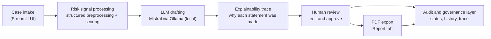

# SAR AI Copilot

**An AI-assisted compliance workstation that turns raw AML case data into an audit-ready Suspicious Activity Report, with a human in the loop and the model running locally.**


> Built by **Team FinNova** (SRMKTR) for **Hack-O-Hire 2026**.

**Jump to:** [Demo](#demo) · [Why it matters](#why-it-matters) · [How it works](#how-it-works) · [Features](#features) · [Run it locally](#run-it-locally) · [Roadmap](#roadmap) · [Product vision](#product-vision)

---

## Demo

Watch one case go from intake to a regulator-ready PDF in about a minute.

<!--
ADD YOUR SCREEN RECORDING HERE:
1. Open this README on github.com and click the pencil (Edit) icon.
2. Drag your .mp4 / .mov file into the editor. GitHub uploads it and inserts a link on its own line.
3. Make sure that link sits on its own line directly under this comment, then delete this whole comment block.
If the file is too big, trim it to 30-60 seconds or upload it to YouTube as Unlisted and paste the link instead.
-->

<!--
ADD 3-4 SCREENSHOTS (create a docs/ folder in the repo and upload the images there), then uncomment:
| Case intake | Risk breakdown |
| --- | --- |
|  |  |
| AI-generated SAR draft | PDF export |
| --- | --- |
|  |  |
-->

> The app runs **locally** on purpose: the language model is served by Ollama on your own machine, so there is no public hosted demo. The video above shows the full flow.

---

## Why it matters

Banks and fintechs are required to report suspicious activity, and the Suspicious Activity Report (SAR) is where that report is written. Drafting one is slow, manual, and inconsistent between analysts. A weak or inconsistent narrative is a compliance risk.

SAR AI Copilot speeds up the drafting step while keeping what regulators care about: a human decision-maker, a record of how every conclusion was reached, and control over where sensitive data goes.

---

## How it works



1. **Intake:** an analyst opens a case in the dashboard.
2. **Risk analysis:** transaction and customer signals are structured and scored, and the breakdown is shown to the analyst.
3. **Drafting:** the structured signals are passed to a local Mistral model through Ollama, which writes the SAR narrative.
4. **Explainability:** the system keeps a trace of the inputs behind the draft, so a reviewer can see why it says what it says.
5. **Review:** the analyst edits and approves the draft. The AI never files anything on its own.
6. **Export:** an approved report is rendered as a PDF, and the case status and trace are stored for audit.

### Why a local model

Case data is some of the most sensitive data a bank holds. Running the model through Ollama keeps drafting on your own machine, so case data does not need to be sent to an external AI API. This is the main architectural choice in the project.

---

## Features

| Area                                       | What it does                                                  |
| ------------------------------------------ | ------------------------------------------------------------- |
| **Case intake dashboard**                  | Browse cases and open one for review                          |
| **Risk breakdown**                         | Structured risk signals and scoring shown alongside each case |
| **AI-generated SAR drafts**                | Narrative generated locally by Mistral via Ollama             |
| **Explainability and trace capture**       | Records what the draft was based on, for review and audit     |
| **Human-in-the-loop workflow**             | Drafts are reviewed and approved by a person before export    |
| **Case lifecycle management**              | Status tracking from intake through approval                  |
| **PDF export**                             | Regulator-ready SAR report generated with ReportLab           |
| **Governance monitoring and SLA tracking** | Visibility into case progress and deadlines                   |

---

## Tech stack

| Layer           | Technology                        |
| --------------- | --------------------------------- |
| Language        | Python                            |
| UI              | Streamlit                         |
| LLM             | Mistral, served locally by Ollama |
| PDF generation  | ReportLab                         |
| Version control | Git and GitHub                    |

---

## Run it locally

**Prerequisites:** Python 3.10+ and [Ollama](https://ollama.com) installed.

```bash
# 1. Get the model
ollama pull mistral

# 2. Clone and install
git clone https://github.com/harshadkumarsasi/sar-ai-copilot.git
cd sar-ai-copilot
python -m venv .venv
source .venv/bin/activate        # Windows: .venv\Scripts\activate
pip install -r requirements.txt

# 3. Make sure Ollama is running, then start the app
streamlit run frontend/app.py
```

Open the URL Streamlit prints (usually http://localhost:8501).

**Data note:** this is a demonstration project. All case data used in it is synthetic.

---

## Roadmap

### 1. Role-based governance dashboard (next)

Today's governance view is a single shared screen. The next step is a polished, role-aware dashboard where each level of authority sees exactly what is relevant to them and can act on it.

| Role                          | Sees                                                            | Can do                                                                        |
| ----------------------------- | --------------------------------------------------------------- | ----------------------------------------------------------------------------- |
| **Analyst**                   | Their assigned cases, risk breakdown, AI draft and trace        | Edit the draft, add notes, submit for review                                  |
| **Reviewer / senior analyst** | Their team's review queue, drafts with the explainability trace | Approve to the next stage, request changes, reassign within the team          |
| **Compliance officer (MLRO)** | Cases awaiting a final decision, escalations, SLA status        | Give final approval or rejection, authorize filing, assign and reassign cases |
| **Audit / admin**             | Full audit trail, governance metrics, model and prompt versions | Export audit logs (read-only), manage roles and SLA rules                     |

Planned with it:

- **Maker-checker (four-eyes) approval chains**, so no one approves their own work.
- **Assignment and workload views**, with SLA breach alerts and escalation rules.
- **Tamper-evident audit log** of every edit, approval, and assignment.

### 2. Better drafting quality

- Citations from each narrative sentence back to the source data, plus automatic checks that the draft does not state anything the evidence doesn't support.
- Evaluation sets to measure narrative quality across models and prompt versions.
- A feedback loop that learns from reviewer edits.

### 3. Integration

- Real-time alert ingestion and connectors to core banking and case-management systems.
- Multi-model risk scoring.
- Multi-jurisdiction report templates (for example FinCEN SARs and India's FIU-IND STRs).

---

## Product vision

The long-term aim is to turn this into a product that compliance teams can adopt.

- **Self-hosted, on-premises deployment** for banks and regulated institutions, so case data never leaves their environment. This is the core selling point of the local-model design.
- **Managed cloud tier** for smaller fintechs and NBFCs that want fast setup, with data residency controls.
- **Pricing aligned to value**, for example per analyst seat or per case processed.
- **What it would take:** enterprise security and access controls, model validation and documentation that regulators expect, and pilots with real compliance teams.
  This is a vision, not a commercial offering. The repository is a working prototype.

---

## Limitations and disclaimer

- AI-written drafts can be wrong or incomplete. **Every report must be reviewed by a qualified person before use.**
- This is a prototype built for a hackathon. It is not a certified compliance product and is not legal advice.
- Performance and draft quality depend on the local model and your hardware.

---

## Team

**Team FinNova**, SRMKTR, built for **Hack-O-Hire 2026**.

---

[GitHub](https://github.com/harshadkumarsasi) · [LinkedIn](https://linkedin.com/in/harshadkumar227)
